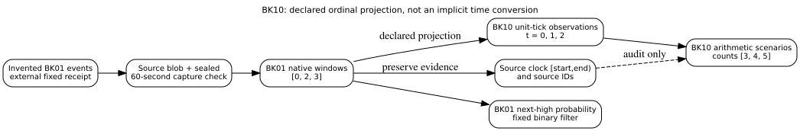

#+title: A Sealed 60-Second Capture Is Not an Abstract Unit Tick
#+author: BK10 world-model capstone integration
#+property: header-args :eval never

* Tested scope and the distinct lesson

This BK10 Project 5 integration handoff consumes the exact BK01 synthetic
source implementation from worker #143, through BK10's previously audited
fixed-inventory capture gate. The new step is deliberately narrow: each
*independently inventoried, complete* 60-second window is mapped to one
contiguous ordinal unit-tick count. It does not equate seconds with model
ticks; it declares the ordinal mapping and preserves the original clock bounds.
The tests exercise the actual BK01 code, while the BK10 encoder in the
cross-contract tests is an explicitly named contract double. End-to-end
execution against the latest canonical BK10 =capstone.py= is NOT RUN here.

The source snapshot is synthetic, not real StarIntel source completeness or a
verified canonical Star Language document. The source reports =0.10.1= for its
synthetic records; that string does not establish validation against the
canonical generated schema. Source authority remains outside this toy.

** Frozen and independently inspectable boundaries

#+begin_example
BK01 invented event inventory and fixed receipt (five events)
  -> exact Git source + event identity + window-seal verifier
  -> BK01 native aggregation: 60-second sealed [0, 2, 3]
  -> BK10 projection: ordinal ticks [0, 1, 2]; row counts [0, 2, 3]
       + parallel provenance map back to Unix [start,end) and event IDs
  -> BK10 v0 count scenarios (contract double here): [3, 4, 5]
  -> BK01 native fixed binary filter: P(next high), separate target
#+end_example

The decoder accepts exactly the record keys =document_id=, =t=, =source=,
=kind=, =count=. There is no future label, wall-clock field, or claim of learned
latent state inside those rows. Provenance lives outside the rows as an
independent =lineage= vector, with exactly matched ordinal indices and source
identities. A 0-count first window is accepted only after independent inventory
and explicit =complete=true= evidence; an omitted event plus recomputed
self-hashes is rejected by the fixed external teaching receipt.

#+caption: The provenance boundary preserves source clock time independently of the ordinal model timebase.
#+attr_html: :alt BK01 sealed events become 60-second windows and separate BK10 unit tick rows, with an independent source lineage map.

** Two outputs that may not be pooled

BK01's =BinaryWorldModel= is a *fixed-parameter* binary hidden-state filter.
Its next-high score is a probability for the observation bucket and is not a
trained, calibrated likelihood from the observed fixture. BK10's 3-count
scenarios are an *untrained arithmetic heuristic*. Their 250000/500000/250000
weights are assigned demonstration weights, not posterior probabilities.

Comparing a next-high probability with a forecast count is invalid; the target
variable, loss, model family and time index all differ. Converting BK01's
60-second source windows into *ordinal count measurements* is explicit and
reversible from the emitted lineage map. Reinterpreting these counts as the
continuous-valued four-history domain of BK06 is NOT justified or implemented.

| Component | Fitted parameters | Training | Local CPU work | Evaluation |
|-
| BK01 fixed binary filter | 0 | None | native 3-window filter | no held-out calibration test |
| BK10 arithmetic count baseline | 0 | None | ordinal-state update | only fixture witness, no held-out generalization |
| BK02 learned encoder | NOT VERIFIED | NOT RUN | NOT RUN | NOT RUN |
| BK06 continuous diffusion | separate candidate | isolated prior evidence only | NOT RUN here | NOT RUN here |

* Executable experiment and regressions

From this isolated checkpoint directory:

#+begin_src sh
python -W error -m unittest -v test_bk01_window_projection
python run_window_projection.py
#+end_src

The 21 tests reject self-rehashed event omission, incomplete or noncontiguous
window seals, booleans as timestamps, wrong provider identity, duplicate
or replacement records, lost observation digests, incompatible capstone version
and off-by-one future horizons. An accepted demonstration emits three sealed
count rows plus a parallel source lineage map. Deterministic replay checks
identity; it does not establish model generalization or deployment coverage.

The BK10 encoder is injected as a dependency, not copied into this adapter.
The injected test double makes the contract testable without claiming that the
currently independent BK10 implementation has been executed in this new run.
Actual BK10 exact-source execution remains a *follow-up acceptance gate*.

* Curricular links and follow-up acceptance

This handoff operationalizes the provenance/leakage controls from the parent
[[file:../../OUTLINE.org][outline]] Chapters 2--5, then distinguishes the
classification target and evaluation concepts of Chapters 7--8. Chapter 20
owns the future canonical StarIntel adapter. The ML-StarIntel
[[file:../../PROJECTS.org][Project 5 capstone]] has a wider entity, retrieval
and graph scope; this checkpoint does not complete that project.

For world-model sequencing, BK01 (#143) defines observations and probabilistic
state filtering; BK02 (#144) still owns learned recurrent state; BK06 (#148)
owns continuous trajectory diffusion; BK07/08 (#149/#150) own the HTML
proposer and held-out benchmark, and BK09 (#151) owns sanitized telemetry
labels. BK10 (#152) composes versioned interfaces only *after* their test and
review gates, and must not rewrite the component chapters.

** Reproduction and engineering exercises

1. Remove the last two synthetic events while recomputing all mutable local
   digests; prove the external frozen receipt rejects the substitution.
2. Replace the seal for an empty first window with an absent/unsealed window;
   explain why =count=0= and =observation missing= are not equivalent.
3. Trace the projected future horizon back to the real 60-second source
   window boundary and intentionally introduce an off-by-one error.
4. Add a typed BK10 actual encoder provider with the exact Git blob and
   rerun the same contract without altering BK01/02/06 owned files.
5. Before claiming final capstone readiness, execute the full book's
   =make book BOOK=ml-starintel=, =make check BOOK=ml-starintel= and
   EPUBCheck on the exact reviewed integration head. These are NOT RUN here.
