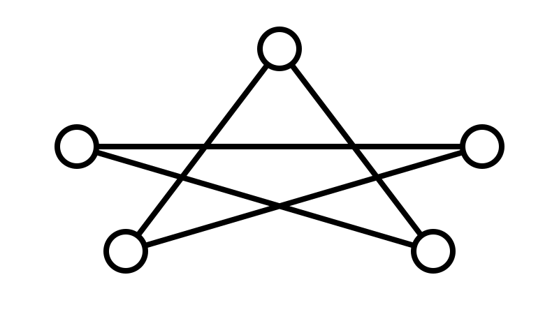

#+title: Bootstrap Publishing Fixture
#+author: chatgpt-books
#+bibliography: references.bib
#+OPTIONS: toc:2 num:t

* Publishing contract
:PROPERTIES:
:ID:       8fec0670-b0c5-5741-9ab5-6d07b7aa9a30
:END:
This fixture proves the real publication path rather than a mock exporter. Pandoc is the selected compiler [cite:@pandoc-manual-2026]. It includes Unicode such as λ, →, α, β, and ∑.

See [[#fixture-resolution][the resolution section]].

** Code block
#+begin_src python
def square(x):
    return x * x

assert square(9) == 81
#+end_src

** Table
| Component | Purpose |
|-----------+---------|
| Org | canonical authoring |
| Pandoc | EPUB 3 compiler |
| EPUBCheck | conformance validation |

** Equation
The quadratic objective is $f(x) = (x-3)^2$ and its derivative is $f'(x)=2(x-3)$.

** Diagram
#+caption: Deterministic fixture flow from canonical Org source through generated assets to validated EPUB.
#+attr_html: :alt Org source flows to generated assets, Pandoc EPUB output, then EPUBCheck validation.
[[file:build/pipeline.svg]]

** Programmatic plot
#+caption: Reproducible quadratic objective generated from source code with its minimum at x equals 3.
#+attr_html: :alt A U-shaped quadratic curve whose minimum is at x equals 3.
[[file:build/objective.png]]

** Image and accessibility
#+caption: Series fixture mark assembled deterministically as SVG, demonstrating ordinary image inclusion.
#+attr_html: :alt A geometric star-like node network used as a publication fixture mark.

A footnote is preserved by the exporter.[fn:fixture]

[fn:fixture] This footnote exists solely to exercise production EPUB footnote handling.

* Resolution
:PROPERTIES:
:CUSTOM_ID: fixture-resolution
:ID:       ae561fc7-3188-59ed-8e5a-a48b829f8618
:END:
This stable section gives the internal cross-reference a deterministic target.

* References
#+print_bibliography:
